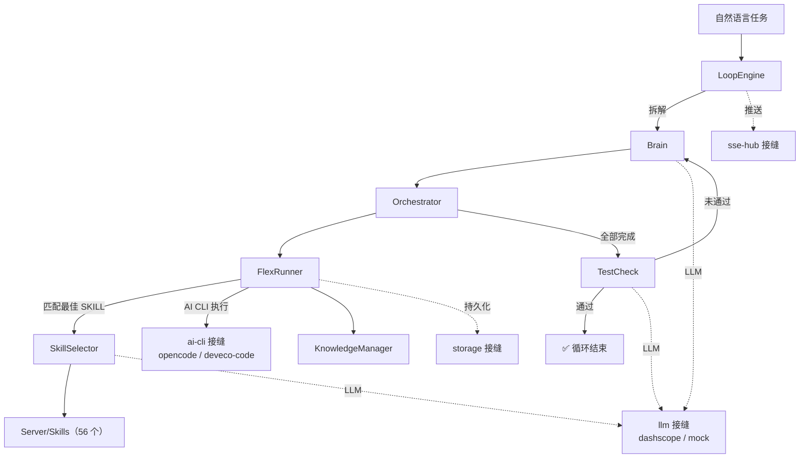

# 🔁 3rdLibraryLoop — AI 大循环编排引擎

> 基于 **Loop Engineering** 范式的 AI 任务自动化编排系统：自然语言任务 → 拆解 → 编排 → 执行 → 准出审核 → 循环迭代，直至满足验收标准。

[](https://nodejs.org/)
[](https://nodejs.org/api/esm.html)
[](#-license)
[](#-测试与质量门禁)

---

## 📖 项目简介

3rdLibraryLoop 是一个面向 **ArkTS / 鸿蒙、React Native、Flutter 三方库** 自动化检视与处理的 AI 编排引擎。它采用「大循环」设计模式，将复杂任务分解为可独立执行的步骤，通过多 SKILL 协同完成全流程闭环：

```
自然语言任务
    │
    ▼
┌──────────────────────────────────────────────────────────┐
│                     LoopEngine（大循环）                  │
│                                                          │
│   ┌─────────┐    ┌──────────────┐    ┌──────────┐       │
│   │  Brain  │───→│ Orchestrator │───→│ TestCheck│       │
│   │ 拆解/重规│    │   编排执行    │    │ 准出审核  │       │
│   └────▲────┘    └──────────────┘    └────┬─────┘       │
│        │                                  │              │
│        └────────── 未通过 ────────────────┘              │
│                                                          │
│   循环终止：准出通过 OR 达到最大循环次数                  │
└──────────────────────────────────────────────────────────┘
```

### 核心能力

| 能力 | 实现位置 | 说明 |
|------|----------|------|
| **🧠 Brain（任务拆解）** | `plugins/engines/brain/` | LLM 把自然语言任务拆解为含依赖关系的步骤图；支持 `replanTask()` 重规划 |
| **🔀 Orchestrator（编排调度）** | `plugins/engines/orchestrator/` | 按依赖关系并行/串行执行，含重试、循环检测、死锁检测、可中途改变配置 |
| **🏃 FlexRunner（步骤执行）** | `plugins/engines/orchestrator/FlexRunner.js` | 语义匹配最佳 SKILL → 通过 AI CLI 执行 → 检查结果 → 持久化；支持暂停/继续/终止 |
| **✅ TestCheck（准出审核）** | `plugins/engines/testcheck/` | 对照验收标准逐条评估，产出结构化审核报告，决定通过或触发重规划 |
| **📚 KnowledgeManager（知识沉淀）** | `plugins/engines/knowledge/` | 把有效经验持久化，跨任务/跨轮次复用；含 MCP 检索引导 |
| **🎯 SkillSelector（SKILL 选择器）** | `plugins/agent/core/SkillSelector/` | ReAct 风格：扫描 SKILL → LLM 拆解语义 → BM25 召回 Top-K → LLM 排序 |
| **🔁 LoopEngine（大循环）** | `plugins/engines/loopengine/` | 协调 Brain → Orchestrator → TestCheck 的闭环与终止条件 |

> ⚠️ 上表的实现位置是本仓库最重要的一条约定：**业务实现都在 `plugins/` 下**，`Server/Brain/`、`Server/TestCheck/` 等目录现在只是转发门面（见下节）。

---

## 🏗️ 架构总览

### 一、一切即插件

系统由三层组成，装配只发生在一个地方：

```
core/（内核）  ──provide/inject──▶  seams/（21 条能力契约，纯常量 + JSDoc、零 import）
                                            ▲
                                            │ 实现
                                     plugins/（14 个插件）
                                            ▲
                                            │ 读取启用配置
                                     profiles/（default.json / mock-llm.json）
```

#### 内核（`core/`，8 文件 ≈ 1070 行）

| 文件 | 职责 |
|------|------|
| `definePlugin.js` | 插件声明与校验（`name` / `seam` / `dependencies` / `apply`） |
| `Context.js` | `provide` / `inject` / `seam@provider` 限定名 / `scoped` 隔离标记 |
| `PluginLoader.js` | 嵌套目录扫描（≤ 4 层），从 `plugins/**` 自动发现插件 |
| `Profile.js` | 启用配置：Kahn 拓扑排序 + `required` 缺失 **fail closed** |
| `PluginHost.js` | 宿主生命周期：`load` / `inject` / `dispose`（拓扑逆序） |
| `hostBridge.js` | 活跃宿主是运行时状态（作用域宿主 ALS > 默认宿主 > 无宿主），对默认宿主设**覆盖守卫** |
| `cstTime.js` | 时间原语（全仓库唯一一份，Store 直接引用） |

#### 接缝（`seams/`，21 条）

能力契约是**纯常量 + JSDoc，零 import**——这样任何插件都能引用它而不产生运行时依赖：

```
ai-cli · app-logger · http-router · llm · message-archive · skill-source · sse-hub · stats · storage
agent-skill-selector · agent-role-limiter · agent-multi-agent-runner
distributed-lease · distributed-queue · distributed-tokens · distributed-observer
engine-brain · engine-knowledge · engine-loop · engine-orchestrator · engine-testcheck
```

#### 插件（`plugins/`，14 个）

| 插件 | 提供的接缝 | 依赖 |
|------|-----------|------|
| `storage/core` | `storage` | — |
| `util/logger` | `app-logger` | — |
| `stats/core` | `stats` | — |
| `llm/dashscope`、`llm/mock` | `llm`（真实 / 离线两实现） | — |
| `cli/opencode` | `ai-cli` | `storage/core`, `util/logger` |
| `cli/deveco-code` | `ai-cli` | `cli/opencode` |
| `agent/core` | `agent-skill-selector` + `agent-role-limiter` + `agent-multi-agent-runner` | — |
| `distributed/core` | `distributed-lease` + `distributed-queue` + `distributed-tokens` + `distributed-observer` | — |
| `engines/brain` | `engine-brain` | — |
| `engines/knowledge` | `engine-knowledge` | — |
| `engines/loopengine` | `engine-loop` | — |
| `engines/orchestrator` | `engine-orchestrator` | — |
| `engines/testcheck` | `engine-testcheck` | — |

> 为什么 14 个插件能覆盖 21 条接缝：`agent/core`（3 条 `agent-*`）与 `distributed/core`（4 条 `distributed-*`）都是「一个内聚实现包 + 一个清单」，`plugin.json` 的 `seam` 字段只写主能力，其余在 `apply` 里一并 `provide`。`cli/deveco-code` 与 `cli/opencode` 是同一接缝的两个提供方，按 `CLI_TYPE` 选择。

#### 装配：`Server/composition/buildApp.js`（唯一装配点）

- 13 个装配键；传入 `host` 时，`storage` / `stats` / 五个 `engine-*` 全部**从接缝取**。
- 缺接缝 **fail closed** 并点名（例如禁用 `engines/brain` 后启动会明确报 `engine-brain` 缺失）。
- `engineSeams: 'allow-builtin'` 是**显式逃生阀**（回落到内置类），不是默认值。
- 进程级宿主是单例，`buildApp` **不**调用 `setActiveHost`——激活是入口的事（见 `core/hostBridge.js` 的覆盖守卫）。

#### 启用配置（`profiles/`）

- `default.json`：生产默认（真实 LLM + 真实 AI CLI）。
- `mock-llm.json`：离线/CI 用（`llm/mock`）。
- 语义：**未提及 = 启用**（`defaultEnabled` 默认 `true`，向后兼容）；写 `defaultEnabled: false` 则变成白名单模式；显式 `enabled` 与 `overrides` 优先级最高。
- 「拔插件」验收要求写 **显式 `enabled: false`**——省略不等于禁用。
- 应急逃生阀：`3LIB_PLUGIN_MODE=off` 等价于不装宿主、走内置装配，**优先于任何构造参数**。

### 二、`Server/` 现在是什么

插件化之后，`Server/**` 里除 HTTP 层与共享工具外，绝大多数文件只剩一行 `export * from '…/plugins/…'`（下面的数字由脚本按「是否只有 re-export」实测得出）：

| 目录 | js 文件 | 仅转发门面 | 含实现 | 定位 |
|------|--------:|-----------:|-------:|------|
| `Routes/` | 23 | 1 | **22** | **真实现**：HTTP 适配层（`server.js` + `routes/*`） |
| `library/` | 8 | 3 | **5** | **真实现**：跨模块共享工具（`AtomicJsonFile` 等） |
| `composition/` | 4 | 1 | **3** | **真实现**：`buildApp` / `envBootstrap`；`hostBridge` 是门面 |
| `CLI/` | 6 | 2 | 4 | 老 CLI 适配层（新入口在 `plugins/cli/*`） |
| `Agent/` | 21 | 18 | 3 | 门面 → `plugins/agent/core`；3 个非门面文件是 `internal/registerFlexRunnerFallback.js` 与 2 个 `__tests__` 脚本 |
| `DbUse/` | 12 | 11 | 1 | 门面 → `plugins/storage/core` |
| `Distributed/` | 11 | 10 | 1 | 门面 → `plugins/distributed/core` |
| `Brain/` `TestCheck/` `Orchestrator/` `LoopEngine/` `FlexRunner/` `Knowledge/` | 18 | **18** | 0 | **全部门面** → `plugins/engines/*` |
| `Skills/` | 2 | 0 | 2 | 56 个 SKILL 技能库（见后文） |

**为什么保留门面**：`Server/` 是历史调用面（`Server/Routes/server.js`、SKILL 提示词里的相对路径、旧脚本），门面让这些入口一字不改地继续工作，同时把实现集中到 `plugins/`。所以——**读实现请看 `plugins/`，改契约请先改 `seams/`。**

### 三、目录结构

```
3rdLibraryLoop/                    # 仓库根 = 核心包 @ohos-cpf/3rdloop_core
├── core/                          # 插件内核（8 文件）
├── seams/                         # 21 条能力契约（22 文件，纯常量）
├── plugins/                       # 14 个插件（108 文件 ≈ 2.6 万行）
│   ├── engines/{brain,knowledge,loopengine,orchestrator,testcheck}/
│   ├── cli/{opencode,deveco-code}/   llm/{dashscope,mock}/
│   └── agent/core/  distributed/core/  stats/core/  storage/core/  util/logger/
├── profiles/                      # default.json / mock-llm.json
├── Server/                        # HTTP 适配层 + 兼容门面 + SKILL + 资产
│   ├── Routes/                    #   server.js + routes/{brain,orchestrator,flexrunner,
│   │                              #   loopengine,knowledge,stats,registry,health,stream}.js
│   ├── composition/               #   buildApp.js（唯一装配点）/ envBootstrap.js
│   ├── Skills/                    #   56 个 SKILL
│   └── Brain|TestCheck|Orchestrator|LoopEngine|FlexRunner|Knowledge|DbUse|Distributed/  # 转发门面
├── cli/                           # 独立 CLI 包 @ohos-cpf/3rdloop（bin/ lib/ workflows/）
├── Web/                           # public/（核心前端）+ ext/（tag|prcheck|issue）+ server.js（兼容入口）
├── test/                          # 验收套件 m1–m14（67 文件 ≈ 1.2 万行）
├── scripts/                       # arch-guard / ci / coverage / release
├── MCP/ Archive/ BadCase/         # 运行期资产（随核心包发布）
├── deploy/                        # Dockerfile + docker-compose.yml
├── Tools/                         # libraryTestScan（独立扫码工具）
├── start-services.mjs             # 一键环境检测 + 起服务
├── check-env.mjs                  # 仅环境检测
└── .github/workflows/ci.yml       # CI 只调用 `npm run ci`
```

### 四、模块协作关系



---

## 🔧 技术栈

| 层级 | 技术 | 说明 |
|------|------|------|
| **运行时** | Node.js ≥ 22（ESM） | `engines.node >= 22`，两份 manifest 一致 |
| **插件内核** | 自研 `core/` | `definePlugin` + Context / Loader / Profile / Host / hostBridge，无第三方 DI 框架 |
| **LLM** | DashScope（OpenAI 兼容端点） | 默认 `LLM_MODEL=glm-5.2`；`llm/mock` 用于离线与 CI |
| **AI CLI** | opencode / deveco-code | 由 `CLI_TYPE` 选择（默认 `deveco-code`），统一经 `ai-cli` 接缝 |
| **存储** | JSON / JSONL / SQLite / File | 四层适配器（`better-sqlite3` 原生模块） |
| **实时通信** | SSE | 按 `taskId` 频道分组推送 |
| **前端** | 原生 HTML/CSS/JS | 无框架、静态托管；扩展通过 `Web/ext/*/manifest.json` 挂载 |
| **文档检索** | SQLite FTS5 + BM25 | `Archive/` 检索模块，jieba-wasm 分词（该模块走 Node 内置 `node:sqlite`） |
| **质量门禁** | 自研套件 + biome + arch-guard | 见「测试与质量门禁」 |

---

## 🚀 快速开始

### 方式 A：装 CLI 来用（使用者）

发布物是**挂在该仓库 Release 上的两个 tarball**（不在公共 npm registry）：

```
ohos-cpf-3rdloop_core-0.0.11.tgz   核心包（引擎 + 插件 + 前端 + 资产）
ohos-cpf-3rdloop-0.0.11.tgz        CLI 包（3rdloop 命令）
SHA256SUMS                          sha256sum 格式的校验清单
RELEASE.md                          产物清单与本文件
```

```bash
# 两个 tarball 必须一起装：CLI 通过 @ohos-cpf/3rdloop_core 依赖核心包，
# 只装 CLI 会去 registry 找旧版核心包
npm i ./ohos-cpf-3rdloop_core-0.0.11.tgz ./ohos-cpf-3rdloop-0.0.11.tgz

npx 3rdloop version        # 打印 CLI 与核心包版本 / 核心树来源
npx 3rdloop doctor         # 环境体检（含 SQLite 原生绑定实测）
npx 3rdloop serve          # 后端 + 前端 + 扩展一体启动
```

升级与回滚：

```bash
3rdloop update --from-release --check     # 只看：当前版本 vs 最新 Release
3rdloop update --from-release --yes       # 下载该 Release 的两个 tarball 并安装
3rdloop update --from-release v0.0.11     # 指定 tag（也可用于回滚）
```

> `--from-release` 是「装这个 release」的显式请求：即使当前版本等于/高于 tag 也会装。

### 方式 B：仓库内开发（贡献者）

前置：**Node.js ≥ 22**；AI CLI（`opencode` 或 `deveco serve`）与 LLM 凭据。

```bash
git clone <repo> && cd 3rdLibraryLoop

# 依赖以**根 manifest** 为准（核心树 + 测试 + 脚本都从这里取）
npm ci

# 原生模块兜底：better-sqlite3 安装时会跑 node-gyp；本机无 Python/C++ 工具链时
# 用下面这条，运行期依赖它自带的 prebuilds（win32-x64 已验证可用）
npm ci --ignore-scripts
```

> `Server/package.json` 是历史遗留的第二份 manifest（`third-library-loop-server`），
> 依赖已全部并入根 manifest；`cli/scripts/verify-deps.mjs` 校验核心树时**以根 manifest 为准**。
> 只有跑老的独立脚本或 `prepack`（生成 `cli/vendor`）时才需要它。

配置 LLM 凭据（三层加载，优先级从高到低：系统环境变量 > `~/.3lib/.env` > `Server/.env`）：

```bash
cp Server/.env.example Server/.env     # 或直接用 CLI 写用户级配置
npx 3rdloop config set DASHSCOPE_API_KEY sk-xxx
```

```ini
DASHSCOPE_API_KEY=your_api_key_here
LLM_BASE_URL=https://dashscope.aliyuncs.com/compatible-mode/v1
LLM_MODEL=glm-5.2
LLM_TEMPERATURE=0.1
LLM_MAX_TOKENS=2048
CLI_TYPE=deveco-code            # opencode | deveco-code
```

### 启动

**推荐：一个进程起全部服务**（后端 3000 + 前端 8080 + `Web/ext` 扩展）：

```bash
node cli/bin/3rdloop.mjs serve
# 或安装后：3rdloop serve

# 常用变体
3rdloop serve --no-ext              # 纯后端操作（仅核心工作台，禁用全部扩展）
3rdloop serve --ext tag,issue       # 白名单挂载
3rdloop serve --port 3000 --web-port 8080
```

| 服务 | 地址 | 说明 |
|------|------|------|
| Server 后端 API | `http://127.0.0.1:3000` | REST + SSE，默认只绑回环 |
| Web 前端 | `http://127.0.0.1:8080` | AI Loop 控制台（自然代理 `/api/*`、`/stream*`） |

> 🔒 对外暴露必须显式给令牌。`3rdloop serve` **没有** `--host` 开关（监听地址由环境变量决定）：
>
> ```bash
> 3LIB_WEB_HOST=0.0.0.0 3LIB_ACCESS_TOKEN=<令牌> 3rdloop serve   # 无令牌会直接拒绝启动
> node Web/server.js --host 0.0.0.0                             # 兼容入口支持 --host，同样需要令牌
> ```
>
> 首次访问用 `http://<host>:8080/?token=<令牌>` 换一次 HttpOnly Cookie，令牌不留在地址栏。

**一键脚本**（含环境检测，沿用旧工作流）：

```bash
node start-services.mjs            # 环境检测 + 起后端/前端/opencode serve
node start-services.mjs --skip-check
node check-env.mjs                 # 只体检
```

**手动分别启动**（兼容入口，等价于 `serve` 的一部分）：

```bash
node Server/Routes/server.js --port 3000 --type opencode      # 仅后端
node Web/server.js --port 8080 --backend http://127.0.0.1:3000  # 仅前端（委托 cli/lib/web.js）
```

### CLI 命令一览

| 层 | 命令 |
|----|------|
| 任务生命周期 | `run` / `submit` / `wait` / `progress` / `abort` / `list` / `result` |
| 单步直通 | `step run` / `step status` / `step result` |
| 固定编排 | `orch run` / `orch load` / `orch start` / `orch progress` / `orch control` / `orch tasks` |
| 工作流 | `run <workflow>` / `workflows`（`cli/workflows/*.mjs` 自动注册） |
| 服务与前端 | `serve`（子命令 `install-ext` / `list-ext` / `remove-ext`） |
| 配置 | `config list/get/set/unset` |
| MCP 装配 | `mcp install` / `mcp uninstall` / `mcp status` |
| 知识回收 | `knowledge export` / `knowledge import` |
| 运维 | `doctor` / `version` / `update` |

退出码约定：`0` 通过 / `1` 参数或环境错误 / `2` 任务失败 / `3` wait 超时 / `130` SIGINT / `143` SIGTERM。

---

## 🧪 测试与质量门禁

```bash
npm test            # 全量 15 个套件（约 60s）
npm run test:m8     # 单跑某个套件
npm run ci          # lint + test（CI 唯一入口，.github/workflows/ci.yml 只调用它）
npm run coverage    # V8 覆盖率（口径见下方「已知缺口」）
```

当前状态（本分支实测）：**15 套件 / 1668 条断言全绿**。

| 套件 | 断言 | 覆盖什么 |
|------|-----:|----------|
| `m1` 阻断级修复 | 8 | 无调试埋点、无弱口令兜底、CORS、访问控制与令牌门禁（含 `?token=` 换 Cookie）、会话回收、优雅停机 |
| `m2` 并发正确性 | 165 | Brain/存储等共享状态在并发下的正确性 |
| `m3` 正确性与一致性 | 160 | SQLite `busy_timeout`、跨进程并发、`seq` 竞态、预编译缓存、知识闭环 |
| `m4` 工程纪律 | 64 | 全量语法检查、脚本/CI 存在性、仓库整洁 |
| `m5` 多 Agent | 166 | Phase 2 多 Agent 架构（角色限制、并发编排） |
| `m6` 高并发 | 131 | Phase 3 高并发场景 |
| `m7` 企业级分布式 | 207 | Phase 4 租约/队列/令牌/追踪 + 部署清单一致性 |
| `m8` 插件内核 | 282 | `definePlugin`/`Context`/`dispose` 拓扑、profile 优先级、`required` fail closed、嵌套发现；**技术债守卫**（副本必须单实现或字节同源） |
| `m9` 契约一致性 | 270 | 21 条接缝按契约**真实构造提供方**并逐成员核对（裸名 + `seam@provider` 限定名） |
| `m10` 宿主作用域 | 66 | ALS 并发隔离、默认宿主覆盖守卫 |
| `m11` 存储 list 语义 | 38 | `list` 前缀语义回归（曾因 Windows 分隔符恒返回空） |
| `m12` CLI 上下文生命周期 | 22 | `RunContext` 出口收口（正常返回 / 抛错 / 信号三条路径） |
| `m13` 从 Release 升级 | 77 | 本地假 GitHub API + **真 tarball**；含 `--check` 不落盘、404、坏包三条路径与临时目录清理 |
| `m14` Web 扩展来源 | 12 | 扩展根解析与 realpath 去重、同名遮蔽可观测 |
| `test:unit` | — | SkillSelector 纯逻辑回归 |

另有四道不在 `npm test` 里的门禁：

| 门禁 | 命令 | 作用 |
|------|------|------|
| 架构守卫 | `node scripts/arch-guard.mjs` | R1 内核纯净 / R2 插件隔离（只可引 `node:`、npm 包、`core/`、`seams/`、自身目录）/ R3 接缝纯净 |
| 依赖声明 | `node cli/scripts/verify-deps.mjs` | 三模式（已装核心包 / `cli/vendor` / 仓库源码）核对 import 与 manifest |
| Lint | `npm run lint` | biome，0 error |
| 发布产物 | `npm run release:pack` | 打两个 tarball + `SHA256SUMS` + `RELEASE.md` |

测试纪律（本仓库的约定，不是建议）：**门禁必须能变红**——每加一条断言，都要把实现改坏证明它红，再还原；契约类断言必须真实构造提供方，不接受只核对声明。

### 已知缺口（诚实清单）

- `scripts/coverage.mjs` 的统计范围仍是 `INCLUDE_PREFIX = <root>/Server`，插件化把实现搬进 `plugins/` 后，它量的是**门面与残留**（实测：`Server` 101 个源文件中 21 个从未加载，表内 36 个文件平均 21.6%，`plugins/**` 一个都不统计）。这个数字目前不可当成绩看。
- 前端 `Web/public/js/**` 没有单元测试，只有访问控制与 `serve` 冒烟。
- 没有真实 LLM / 真实 AI CLI 的端到端测试（全部 stub 与假服务，这是刻意的成本取舍）。
- 仓库目前**没有 `LICENSE` 文件**（两份 manifest 都声明 MIT）。

---

## 📦 双包发布

仓库根**本身就是核心包**，`cli/` 是 CLI 包，二者版本号必须一致（`scripts/release.mjs` 会断言）。

| 包 | manifest | `files` 白名单 | 依赖 |
|----|----------|----------------|------|
| `@ohos-cpf/3rdloop_core` | 根 `package.json` | `Server plugins core seams profiles MCP Archive BadCase Web/public Web/ext README.md` | 核心树用到的全部运行时依赖 |
| `@ohos-cpf/3rdloop` | `cli/package.json` | `bin lib workflows README.md`（**无 vendor、无前端副本**） | `@ohos-cpf/3rdloop_core` + `dotenv` |

CLI 定位核心树时按四级解析（`cli/lib/core-paths.js`，唯一真源）：

| 级别 | 来源 | 场景 |
|------|------|------|
| ① | `3LIB_CORE_DIR` | 运维/测试显式覆盖（写错即报错，不静默降级） |
| ② | 已安装 `@ohos-cpf/3rdloop_core` | **双包发布态正路** |
| ③ | `cli/vendor` | `npm run prepack` 产物（单包回退 / 本地调试） |
| ④ | 仓库根（`cli/` 的上一级） | 开发期直引源码 |

打产物与发布：

```bash
npm run release:pack        # → dist/{两个 tgz, SHA256SUMS, RELEASE.md}（不联网、不调 git/gh）
git tag v0.0.11 && git push origin v0.0.11
# 然后在仓库的 Release 页上传四个附件；已安装用户用
#   3rdloop update --from-release
```

---

## 🎯 SKILL 技能库

`Server/Skills/` 下共 **56 个 SKILL**，按平台与阶段组织：

| 分类 | 数量 | 代表 |
|------|-----:|------|
| **RN / RNOH** | 24 | `rn-code-check`、`rn-library-stability-check`、`rn-library-known-issue-check`、`rnoh-lib-test-align`、`rnoh-cptf-test-run`、`rn-ohos-xts-generator` |
| **ArkTS / 鸿蒙** | 17 | `arkts-code-check`、`arkts-library-{stability,code-quality,memory-leak,documentation-quality,test-coverage}-check`、`arkts-library-compile-validate`、`arkts-library-xts-*` |
| **Flutter** | 7 | `flutter-code-check`、`flutter-library-{consistency,memory-leak,stability,test-coverage,documentation-quality}-check` |
| **TPC / C++** | 1 | `tpc-cpp-check` |
| **通用流程** | 7 | `task-decomposition`（拆解）、`acceptance-check`（准出）、`task-analysis`、`skill-generator`、`knowledge-import`、`gitcode-repo-fork`、`ohos-lib-pr-push` |

`3rdloop run <workflow>` 走 `cli/workflows/*.mjs` 注册的固定编排，`specifiedSkill` 直接绑定上述 SKILL 目录名以跳过选择器。

---

## 📡 API 概览

后端默认 `http://127.0.0.1:3000`，前端把 `/api/*` 与 `/stream*` 反代过来（并按 `Web/ext` 追加扩展路由）。

| 路径前缀 | 路由数 | 说明 |
|----------|-------:|------|
| `/api/health` | 3 | 健康检查（含 AI CLI 连通性） |
| `/api/brain/*` | 5 | 任务拆解 |
| `/api/orchestrator/*` | 12 | 加载任务 / 启动 / 进度 / 控制 |
| `/api/flexrunner/*` | 17 | 步骤执行（对话、控制、文件操作） |
| `/api/loopengine/*` | 7 | 大循环启动 / 进度 / 终止 |
| `/api/knowledge/*` | 7 | 知识库检索与写入 |
| `/api/stats/*` | 3 | 运行统计 |
| `/api/registry/*` | 3 | 任务注册表（历史分页） |
| `/stream` | 2 | SSE 实时推送（按 taskId 订阅） |
| `/api/ext-registry` | — | 前端扩展清单（由 Web 层本地响应，未挂扩展时静默隐藏导航分区） |

```bash
curl -X POST http://127.0.0.1:3000/api/loopengine/start \
  -H "Content-Type: application/json" \
  -d '{"taskDescription":"检视 ArkTS 三方库 xxx 的代码质量与稳定性","maxLoops":3}'
```

---

## 🗄️ 存储架构

四层分层，统一管理所有持久化数据：

```
┌─────────────────────────────────────────────┐
│  Store 层（SessionStore / TaskStepStore /   │  业务语义
│  TaskExecutionStore / TaskRegistryStore）    │
├─────────────────────────────────────────────┤
│  StorageManager                             │  工厂 / 注册表 / 根目录
├─────────────────────────────────────────────┤
│  Adapter 层（Json / Jsonl / Sqlite / File） │  存储格式实现
└─────────────────────────────────────────────┘
```

数据目录由 `StorageManager` 解析，优先级：`options.rootDir` > `3LIB_DATA_DIR` > 默认值（默认值两处不同）：

| 运行方式 | 默认数据目录 | 覆盖方式 |
|---------|-------------|---------|
| 服务端（`Server/Routes/server.js` 等） | **仓库所在目录的上一级**下的 `db/`（与插件化前一致） | `3LIB_DATA_DIR` / `createStorage({ rootDir })` |
| CLI（`3rdloop`） | `~/.3lib/3rdloop/db`（用户级、跨平台） | `--data-dir` / `3LIB_DATA_DIR` / `3rdloop config set 3LIB_DATA_DIR` |

```
<数据目录>/
├── Session/          # 对话存档：<sid>.jsonl（append-only）+ <sid>.meta.json
├── TaskStep/         # 任务步骤（SQLite）
├── TaskRegistry/     # 任务注册表（SQLite，registry.db，供历史列表分页）
├── task/             # 任务产物：<taskId>/stepid_<stepId>.json
├── Artifacts/        # 文件产物
└── Knowledge/        # 经验知识库：index.json + kn_xxxx.json
```

---

## 🧩 核心模块详解

| 模块 | 实现文件 | 行数 | 要点 |
|------|---------|-----:|------|
| **LoopEngine** | `plugins/engines/loopengine/LoopEngine.js` | 1140 | 协调 Brain → Orchestrator → TestCheck；未通过触发重规划；终止条件为准出通过或达到最大循环次数（默认 3） |
| **Orchestrator** | `plugins/engines/orchestrator/Orchestrator.js` | 2289 | 按依赖调度：无依赖并行、成功走 `nextStepId`、失败走 `failStepId`；含循环/死锁检测与运行时改配置 |
| **FlexRunner** | `plugins/engines/orchestrator/FlexRunner.js` | 1892 | 单步骤执行：初始化上下文 → 匹配 SKILL → 经 `ai-cli` 执行 → 检查结果 → 持久化；支持暂停/继续/终止 |
| **Brain** | `plugins/engines/brain/Brain.js` | 726 | 拆解为步骤图（`DecompositionStrategies` / `AnalysisStrategies` 可插拔）；`replanTask()` 重规划 |
| **TestCheck** | `plugins/engines/testcheck/TestCheck.js` | 723 | 对照验收标准逐条评估，产出结构化报告 |
| **KnowledgeManager** | `plugins/engines/knowledge/KnowledgeManager.js` | 446 | 经验持久化与复用；`KnowledgeImporter` 处理导入 |
| **SkillSelector** | `plugins/agent/core/SkillSelector/`（`core/Agent.js` 202 行 + `scanner/skillScanner.js` 347 行 + `matcher/fuzzyMatcher.js` 385 行） | 1000+ | ReAct：扫描 SKILL → LLM 拆解语义 → BM25 召回 Top-K → LLM 排序 |
| **插件内核** | `core/` | 1070 | 见「架构总览 / 内核」 |

> 引擎之间**不直接互相 import**，一律经 `seams/engine-*` 契约取（`arch-guard` 的 R2 强制）；这也是「拔掉 `engines/brain` 后 `buildApp` 会 fail closed 并点名」的原因。

---

## 📄 License

MIT（`package.json` 与 `cli/package.json` 均为 `"license": "MIT"`）。

> 仓库目前还没有 `LICENSE` 文件，建议补一份与 manifest 一致的文本。
