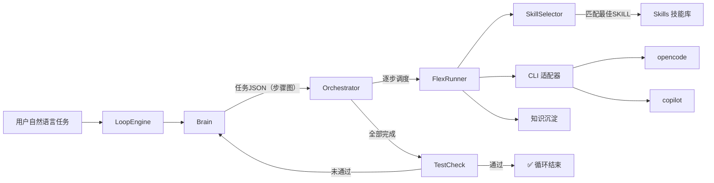

# 🔁 3rdLibraryLoop — AI 大循环编排引擎

> 基于 **Loop Engineering** 范式的 AI 任务自动化编排系统：自然语言任务 → 拆解 → 编排 → 执行 → 准出审核 → 循环迭代，直至满足验收标准。

[](https://nodejs.org/)
[](https://nodejs.org/api/esm.html)
[](LICENSE)

---

## 📖 项目简介

3rdLibraryLoop 是一个面向 **ArkTS / 鸿蒙三方库** 自动化检视与处理的 AI 编排引擎。它采用「大循环」设计模式，将复杂任务分解为可独立执行的步骤，通过多 SKILL 协同完成全流程闭环：

```
自然语言任务
    │
    ▼
┌──────────────────────────────────────────────────────────┐
│                     LoopEngine（大循环）                  │
│                                                          │
│   ┌─────────┐    ┌──────────────┐    ┌──────────┐       │
│   │  Brain  │───→│ Orchestrator │───→│ TestCheck│       │
│   │ 拆解/重规│    │   编排执行    │    │ 准出审核  │       │
│   └────▲────┘    └──────────────┘    └────┬─────┘       │
│        │                                  │              │
│        └────────── 未通过 ────────────────┘              │
│                                                          │
│   循环终止：准出通过 OR 达到最大循环次数                  │
└──────────────────────────────────────────────────────────┘
```

### 核心能力

- **🧠 Brain（任务拆解）**：接收自然语言任务描述，通过 LLM 拆解为含依赖关系的步骤图
- **🔀 Orchestrator（编排调度）**：按依赖关系并行/串行执行步骤，支持重试、循环检测、死锁检测
- **🏃 FlexRunner（步骤执行）**：语义匹配最佳 SKILL，通过 CLI（opencode/copilot）执行
- **✅ TestCheck（准出审核）**：对照验收标准逐条评估，决定是否通过或触发重规划
- **📚 KnowledgeManager（知识沉淀）**：将有效经验持久化，实现跨任务/跨轮次复用
- **🎯 SkillSelector（SKILL 选择器）**：ReAct Agent，BM25 模糊匹配 + LLM 排序，自动选出最佳 SKILL

---

## 🏗️ 架构总览

### 目录结构

```
3rdLibraryLoop/
├── Server/                         # 后端服务
│   ├── LoopEngine/                 # 大循环协调引擎（入口）
│   ├── Brain/                      # 任务拆解引擎
│   ├── Orchestrator/               # 编排调度器 + StepNode 步骤模型
│   ├── FlexRunner/                 # 通用执行模块
│   ├── TestCheck/                  # 准出审核引擎
│   ├── Knowledge/                  # 知识沉淀系统
│   ├── Agent/
│   │   └── SkillSelector/          # SKILL 选择器 ReAct Agent
│   ├── CLI/                        # CLI 适配器（opencode / copilot）
│   ├── DbUse/                      # 统一持久化存储（Json/Jsonl/Sqlite/File）
│   ├── Routes/                     # HTTP 路由 + 控制器 + SSE 推送
│   ├── Skills/                     # SKILL 技能库
│   ├── library/                    # 公共工具（CST时间、统计服务）
│   └── Scripts/                    # 脚本目录
│
├── Web/                            # 前端静态服务 + 反向代理
│   ├── server.js                   # 静态托管 + /api/* 代理到后端
│   └── public/                     # 大循环控制台 UI
│       ├── loop.html
│       ├── loop.css
│       └── loop.js
│
├── Archive/                        # 本地文档检索引擎（SQLite FTS5）
├── db/                             # 运行时数据目录
│   ├── Knowledge/                  # 经验知识库
│   ├── Session/                    # 对话存档（jsonl + meta）
│   └── task/                       # 任务产物
│
├── package.json
├── AGENTS.md
└── README.md
```

### 模块协作关系



---

## 🔧 技术栈

| 层级 | 技术 | 说明 |
|------|------|------|
| **运行时** | Node.js ≥ 22 | ESM 模块，内置 `node:sqlite` |
| **LLM** | 百炼 / DashScope（GLM-5.1） | OpenAI 兼容端点，ReAct 推理 |
| **CLI 引擎** | opencode / copilot | 双适配器统一封装 |
| **存储** | JSON / JSONL / SQLite / File | 四层适配器架构，统一管理 |
| **实时通信** | SSE（Server-Sent Events） | 按任务频道分组推送 |
| **前端** | 原生 HTML/CSS/JS | 无框架依赖，静态托管 |
| **文档检索** | SQLite FTS5 + BM25 | Archive 模块，jieba-wasm 分词 |

---

## 🚀 快速开始

### 1. 环境准备

```bash
# Node.js ≥ 22（需内置 node:sqlite 模块）
node --version

# 安装依赖
cd 3rdLibraryLoop
npm install
cd Server && npm install
```

### 2. 配置环境变量

```bash
cd Server
cp .env.example .env
```

编辑 `Server/.env`：

```ini
# 百炼平台 API Key（必填）
DASHSCOPE_API_KEY=your_api_key_here

# LLM 端点与模型
LLM_BASE_URL=https://dashscope.aliyuncs.com/compatible-mode/v1
LLM_MODEL=glm-5-1

# 采样参数（可选）
LLM_TEMPERATURE=0.1
LLM_MAX_TOKENS=2048
LLM_ENABLE_THINKING=false

# SkillSelector 配置（可选）
SELECTOR_TOP_K=5
SELECTOR_HIT_THRESHOLD=60
FALLBACK_MODEL=qwen3.7-max
```

### 3. 启动服务

```bash
# 启动后端 API 服务（默认 127.0.0.1:3000）
node Server/Routes/server.js --port 3000 --type opencode

# 启动前端 Web 服务（默认 8080，自动代理 /api/* 到后端）
node Web/server.js --port 8080 --backend http://127.0.0.1:3000
```

访问 `http://localhost:8080` 即可打开 **AI Loop 大循环控制台**。

---

## 🎯 SKILL 技能库

系统内置以下 SKILL，覆盖 ArkTS/鸿蒙三方库检视全流程：

| SKILL | 阶段 | 说明 |
|-------|------|------|
| `task-decomposition` | 规划 | 自然语言任务拆解为步骤图 |
| `acceptance-check` | 审核 | 任务准出审核，逐条评估验收标准 |
| `arkts-code-check` | 检视 | ArkTS 三方库 PR 代码检视（多平台） |
| `arkts-library-stability-check` | Phase 2 | 稳定性检视（异常处理、资源释放、并发安全） |
| `arkts-library-code-quality-check` | Phase 3 | 编码质量检视（华为 ArkTS 编程规范） |
| `arkts-library-memory-leak-check` | Phase 4 | 内存泄露检视（生命周期、NAPI 引用管理） |
| `arkts-library-documentation-quality-check` | Phase 5 | 文档质量检视（完整性、准确性、JSDoc） |
| `arkts-library-test-coverage-check` | Phase 6 | 用例覆盖度检视（公开接口测试覆盖） |

---

## 📡 API 概览

所有 API 通过后端 `http://127.0.0.1:3000` 提供，前端通过反向代理访问 `/api/*`。

### 主要路由

| 路径 | 方法 | 说明 |
|------|------|------|
| `/api/health` | GET | 健康检查（CLI 服务状态） |
| `/api/brain/*` | POST | 任务拆解（Brain 引擎） |
| `/api/orchestrator/*` | POST | 编排调度（加载任务、启动、查询进度） |
| `/api/flexrunner/*` | POST | 步骤执行（对话、控制、文件操作） |
| `/api/loopengine/*` | POST | 大循环控制（启动、进度、终止） |
| `/stream` | GET | SSE 实时推送（按 taskId 频道订阅） |

### 启动大循环示例

```bash
curl -X POST http://127.0.0.1:3000/api/loopengine/start \
  -H "Content-Type: application/json" \
  -d '{
    "taskDescription": "检视 ArkTS 三方库 xxx 的代码质量与稳定性",
    "maxLoops": 3
  }'
```

---

## 🗄️ 存储架构

采用四层分层设计，统一管理所有持久化数据：

```
┌─────────────────────────────────────────────┐
│  Store 层 (SessionStore / TaskStepStore)    │  业务语义
├─────────────────────────────────────────────┤
│  StorageManager                             │  工厂/注册表/根目录
├─────────────────────────────────────────────┤
│  Adapter 层 (Json / Jsonl / Sqlite / File)  │  存储格式实现
└─────────────────────────────────────────────┘
```

### 数据目录布局

```
db/
├── Knowledge/              # 经验知识库
│   ├── index.json          # 经验索引（全部记录摘要）
│   └── kn_xxxx.json        # 单条经验详情
├── Session/                # 对话存档
│   ├── <sid>.jsonl         # 消息流（append-only）
│   └── <sid>.meta.json     # 元信息
└── task/                   # 任务产物
    └── <taskId>/           # 按任务 ID 组织
```

---

## 🧩 核心模块详解

### LoopEngine — 大循环协调引擎

协调 Brain → Orchestrator → TestCheck 的完整闭环。审核未通过时自动触发 Brain 重新规划，进入下一轮循环。循环终止条件：准出通过或达到最大循环次数（默认 3 次）。

### Brain — 任务拆解引擎

通过 LLM 将自然语言任务拆解为含依赖关系的步骤图，产出 Orchestrator 可直接消费的任务 JSON。支持 `replanTask()` 重规划。

### Orchestrator — 编排调度器

接收任务 JSON，按依赖关系调度执行：无依赖步骤并行、成功走 `nextStepId`、失败走 `failStepId`。内置循环检测和死锁检测，支持运行时配置修改。

### FlexRunner — 通用执行模块

单步骤执行引擎：初始化上下文 → 语义匹配 SKILL → 通过 CLI 执行 → 检查结果 → 持久化。支持暂停/继续/终止控制。

### SkillSelector — SKILL 选择器 ReAct Agent

采用 ReAct（Reason + Act）设计模式：先扫描 SKILL 目录，再通过 LLM 拆解任务语义，然后用 BM25 模糊匹配召回 Top-K 候选，最后 LLM 排序选出最佳 SKILL。

### TestCheck — 准出审核引擎

对照 Brain 生成的任务级验收标准，逐条评估执行产物是否满足准出条件，产出结构化审核报告（通过/未通过 + 改进建议）。

---

## 📄 License

Apache-2.0
