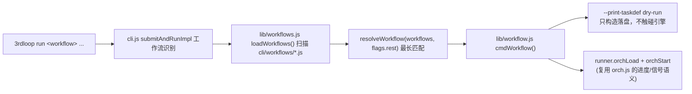

# cli —— 嵌入式引擎 CLI（@ohos-cpf/3rdloop_dev）

本目录是 3rdLibraryLoop 的嵌入式命令行工具包，直接复用 `Server/` 核心引擎
（LoopEngine / Brain / Orchestrator / FlexRunner / TestCheck / Knowledge），
无需启动 HTTP 服务即可从终端跑完整"任务拆解 → 编排执行 → 准出审核"大循环。

> 定位：**嵌入式模式**（`Loop Cli封装计划.md` 方案 A）——单进程内组装核心引擎依赖，
> 仅依赖 `opencode serve`(4096) + LLM 凭据；上 npm 以 `@ohos-cpf/3rdloop_dev` 发布。

## 目录结构

```
cli/
├── AGENTS.md            # 本文档
├── package.json         # bin: 3rdloop；files: bin/lib/vendor/README.md
├── bin/3rdloop.mjs         # 入口：argv 解析 + 退出码归一（任何异常 → 1）
├── lib/
│   ├── cli.js           # 命令分发（run/submit/step/orch/workflows...）
│   ├── config.js        # 环境装配：项目根/.env 链/数据目录/SKILL 目录/taskId
│   ├── runner.js        # 核心引擎组装（复刻 server.js 依赖注入）+ 执行能力
│   ├── queries.js       # 磁盘直读查询（progress/list/result，不实例化引擎）
│   ├── ui.js            # stdout/stderr 输出契约 + 增量 diff 渲染
│   ├── opencode.js      # opencode serve 生命周期管理（探测/拉起/清理）
│   ├── step.js          # 3rdloop step 单步执行（FlexRunner 直连）
│   ├── orch.js          # 3rdloop orch 多步骤编排（Orchestrator）
│   ├── workflow.js      # 工作流执行器（固定编排入口，本期新增）
│   ├── workflows.js     # 工作流注册表/加载器（目录自动加载，本期新增）
│   └── exit-codes.js    # 退出码约定
├── workflows/           # 工作流注册目录（每个 .js/.mjs 自动注册一个工作流）
├── scripts/
│   ├── prepack.mjs      # 发布期：复制 Server/ → cli/vendor/Server/
│   ├── clean-vendor.mjs # 发布后：删除本地 cli/vendor/
│   └── verify-deps.mjs  # 校验引擎 import 的依赖已声明
└── README.md            # 用户文档
```

## 核心机制：依赖注入链（runner.js）

CLI 复用核心引擎的关键是**复刻 `Server/Routes/server.js` 的组装逻辑，但不启动 HTTP**。
`RunContext._init()` 完成依赖注入链：

```
storage(用户数据目录)
  ├─ CLIController(共享, archive 指向本 storage 的 SessionStore)
  ├─ BrainController(注入 cli/orchestratorController/skillDirectory)
  ├─ TestCheck(注入 cli/storage/skillDirectory)
  ├─ LoopEngineController → createLoopEngine()
  └─ orchestratorController.flexRunnerFactory = createOrchestratorFlexRunnerFactory(this)
```

**关键设计（data 错位教训）**：
- 每个 FlexRunner 通过 `createOrchestratorFlexRunnerFactory` 注入**共享** cli/storage/knowledgeManager，
  避免 opencode 会话归档/知识沉淀落到 vendor 相对路径（`cli/db`）。
- 该 factory **必须用普通 function（非箭头）**——Orchestrator 以
  `this.flexRunnerFactory(node, inputReport)` 调用，`this` 即 Orchestrator 实例，
  需访问 `_taskId` / `_loopCount`。

## vendor 双模式

- **开发期**：`npm link` 直引仓库 `Server/` 源码（`resolveVendorServer()` 回退 `../Server`），零副本。
- **发布期**：`prepack` 复制核心模块 → `cli/vendor/Server/` → 打包 → `postpack` 自动删除。
  `.gitignore` 忽略 vendor，手工改动无效（下次打包重新生成）。
- `verify-deps` 双模式扫描（有 vendor 扫 vendor，否则回退 `Server/` 源码）。

## 输出契约

- **stdout**：只放 `--json` 结构化数据或最终结果（脚本可安全解析）
- **stderr**：进度日志 / 诊断信息
- `cli.js` 顶部 `_redirectStdoutLogs()` 把 Server 内部 `console.log/info` 重定向到 stderr，
  `console.debug` 丢弃，保护 `--json` 通道纯净
- **退出码**：`0` 通过 / `1` 参数或环境错误 / `2` 任务失败 / `3` wait 超时 /
  `130` SIGINT / `143` SIGTERM

## 工作流机制（本次新增）

### 定位

**固定编排 = 预置 taskDef 定义 + CLI flags 参数化 + 复用 orch 链路。**
前端（`Web/public/js/*librarycheck.js`）就是这种模式（硬编码 `_RN_STEP_DEFS` 等
steps 定义 → `POST /api/orchestrator/load` → `start`）。CLI 工作流是其命令行等价物：
`3rdloop run <工作流名> --flag <值>` → 运行时构造具参 taskDef → 复用 `orchLoad` + `orchStart`。

### 运行链路



### 工作流文件约定（cli/workflows/*.js）

每个文件默认导出一个对象即可自动注册：

```js
export default {
  name: 'pr push',                 // 多词名，空格分隔；分发时最长匹配
  description: '简述',
  params: [                        // CLI flags schema（驱动校验 / --help）
    { flag: 'workspace-dir', required: true,  describe: '...' },
    { flag: 'upstream-url', required: false, describe: '...' },
  ],
  buildTaskDef(params, env) {      // params: { 'workspace-dir': <值>, ... }
    return {
      taskId: '',                  // 缺省时 CLI 补全（generateTaskId()）
      title: '...',
      skillDirectory: '',
      loopCount: 0,
      steps: [{ stepId: 1, taskDescription: '...', specifiedSkill: '...',
                dependId: 0, nextStepId: 0, failStepId: 0, maxRetries: 3, inputReport: '' }],
    };
  },
};
```

- steps 格式与 `3rdloop orch run <task-def.json>` 的 taskDef 完全一致（Orchestrator.loadTask 协议）
- 步骤职责能匹配某可用 SKILL 时写入 `specifiedSkill`（执行层跳过 SkillSelector）
- `buildTaskDef` 第二参 `env` 携带 `{ dataDir }`，需要落盘相对路径时使用

### 命令面

- `3rdloop workflows`：列出已注册工作流（json / 文本）
- `3rdloop run <wf> --help`：打印该工作流参数说明（退出码 0）
- `3rdloop run <wf> ...` / `3rdloop submit <wf> ...`：执行（两者都支持工作流名）
- `3rdloop run <wf> ... --print-taskdef`：dry-run，构造并落盘 `task-def.dry.json`，不触碰引擎

**分发规则**：`submitAndRunImpl` 先用 `loadWorkflows()` + `resolveWorkflow()` 对
`flags.rest` 做最长匹配；**命中 → 转发 cmdWorkflow()；未命中 → 保持原"任务描述"语义**
（向后兼容 `3rdloop run "检视 xxx"` 完全不变）。

### 已知坑 / 实现要点

- **加载失败不阻断**：`loadWorkflows()` 对加载失败/缺 name/重名模块只记 warnings 跳过，
  但所有工作流目录为空时 `3rdloop workflows` 应给指引（退出码 0）。
- **taskId 必填**：`runner.orchLoad` 要求 `taskDef.taskId` 非空；工作流未显式给时，
  执行器在构造后统一补 `generateTaskId() + '_wf'` 后缀。
- **`--print-taskdef` 不触 opencode**：dry-run 分支在 `_ensureOpcodene` 之前返回，
  验收已实测不会拉起/连接 opencode。
- **多词匹配截断**：`resolveWorkflow` 只对连续位置参数前缀匹配（遇 `--flag` 截断），
  避免把 flag 值错当工作流名。
- **未知 flag 报错**：执行器校验 `--print-taskdef` 之外的未声明 flag → 退出码 1。
- **信号处理**：正式执行沿用 orch.js 模式——SIGINT/SIGTERM → `orchControl(abort)` →
  `oc.stop()` 清 opencode 子进程 → 退出 130/143。

### 职责边界（重要）

- **本期只交付机制，不预置业务工作流**（`pr push` 等由其他项目开发者按约定注册）
- **不改动 `Server/Skills/` 下任何 SKILL**；业务 SKILL 归其他开发者维护
- 工作流只做"参数 → taskDef"，执行细节由 `specifiedSkill` 绑定的 SKILL 承载

## 如何新增一个固定编排命令（面向 AI agent）

**一句话**：在 `cli/workflows/` 下新建一个 `.mjs` 文件，默认导出工作流声明对象，自动注册为
`3rdloop run <name>` 命令。零改动分发代码。

**范本**：[`cli/workflows/pr-check.mjs`](workflows/pr-check.mjs) 是最简完整示例，新建工作流时先通读它。

### 第 1 步：新建文件

在 `cli/workflows/` 下新建 `<name>.mjs`（文件名随意，但建议与 `name` 字段一致）。默认导出一个
对象即可自动注册，无需改动 `cli/lib/cli.js` / `workflows.js` / `workflow.js`。

### 第 2 步：声明 name 与 description

- `name`：命令名，用户通过 `3rdloop run <name>` 触发。**用连字符单词**（如 `pr-check`、`pr-push`），
  不用空格分隔多词——连字符写法语义清晰，避免"是否逐级路由"的歧义。
- `description`：一句话简述，供 `3rdloop workflows` 列表与 `--help` 展示。

### 第 3 步：声明 params（CLI flags schema）

`params` 是数组，每项 `{ flag, required, describe }`：

- `flag`：去掉 `--` 前缀的参数名，如 `pr-url`
- `required`：是否必填（缺填时执行器报错退出码 1）
- `describe`：帮助文本

执行器据此做：必填校验、未知 flag 报错、`--help` 渲染。`--print-taskdef` 是框架级 flag，无需声明。

### 第 4 步：实现 buildTaskDef(params, env)

核心职责：把 CLI 参数构造为与 `Orchestrator.loadTask` 对齐的 taskDef 对象。返回值必须包含
`taskId` + 非空 `steps` 数组。

- `params`：`{ 'pr-url': <值>, 'library-type': <值>, ... }`，key 与 `params[].flag` 对应
- `env`：`{ dataDir }`，需落盘相对路径时使用
- 必填参数缺失时主动 `throw new Error(...)`，执行器会捕获并报错退出码 1
- 非法参数值（如不支持的枚举）同样 throw

taskDef 字段约定（与 `3rdloop orch run <task-def.json>` 完全一致）：

```js
return {
  taskId: '',              // 缺省时 CLI 补 generateTaskId()+'_wf'；需与前端协同时自定义前缀
  title: '...',             // 供前端历史页解析（可编码类型/参数）
  skillDirectory: '',      // 留空用默认 Server/Skills
  loopCount: 0,
  steps: [{
    stepId: 1,
    taskDescription: '...',  // 发给 LLM 的任务描述
    dependId: 0,            // 0=无依赖（入口步骤）
    nextStepId: 0,          // 0=成功后无后续
    failStepId: 0,          // 0=失败即终止
    maxRetries: 3,
    skillDirectory: '',
    specifiedSkill: '...',   // 绑定 SKILL（name 或目录名），跳过 SkillSelector 自动匹配
    inputReport: '',
  }],
};
```

### 第 5 步：dry-run 验收

新建工作流后必跑（零 LLM 成本）：

```bash
# 1. 列表能查到
node cli/bin/3rdloop.mjs workflows

# 2. 参数说明正常
node cli/bin/3rdloop.mjs run <name> --help

# 3. dry-run 构造的 taskDef 正确
node cli/bin/3rdloop.mjs run <name> --<必填flag> <值> --print-taskdef

# 4. 缺必填 / 非法值 / 未知 flag → 退出码 1
node cli/bin/3rdloop.mjs run <name> --print-taskdef    # 缺必填
```

验收后清理 dry-run 产物（`<数据目录>/task/<taskId>/task-def.dry.json`）。

### 易踩坑提醒

- **name 用连字符**：`pr-check` 而非 `pr check`。路由是注册表查找式（`resolveWorkflow` 把位置参数
  `join(' ')` 拼字符串查 Map），不是逐级 switch 分发；连字符写法让"一个命令"的语义更清晰。
- **specifiedSkill 要对**：值必须是 `Server/Skills/` 下某 SKILL 的目录名或 frontmatter `name` 字段；
  解析失败会降级为无 SKILL 模式（仍耗 LLM 但不按预期执行）。
- **taskId 前缀与前端协同**：若希望 CLI 提交的任务在前端某历史页可见，taskId 前缀需与前端过滤条件
  一致（如 PR 检视页用 `taskIdPrefix=codecheck_`）。参考 `pr-check.mjs` 的
  `codecheck_{owner}_{repo}_{prNum}_{ts36}` 格式。
- **不改 SKILL**：工作流只做"参数 → taskDef"，执行细节由 `specifiedSkill` 绑定的 SKILL 承载。
  新增业务能力应注册新工作流 + 复用现有 SKILL，不改动 `Server/Skills/`。

## 命令家族

| 层 | 命令 | 复用引擎 |
|----|------|---------|
| 任务生命周期 | `run`/`submit`/`wait`/`progress`/`abort`/`list`/`result` | LoopEngine 全闭环 |
| 单步直通 | `step run`/`status`/`result` | FlexRunner 直连 |
| 固定编排 | `orch run`/`load`/`start`/`progress`/控制/`tasks` | Orchestrator |
| **工作流** | `3rdloop run <wf>`/`3rdloop workflows` | Orchestrator + 注册表 |
| 运维 | `doctor`/`version` | check-env 维度 |

## 环境约定

- `.env` 加载链：系统环境变量 > `~/.3lib/.env`（用户级） > 项目根 `Server/.env`。
  `loadEnvChain` 必须在任何核心引擎 import 前执行（使 Server 内部 dotenv 变静默 no-op）。
- 数据目录：`~/.3lib/3rdloop/db`（`--data-dir` / `3LIB_DATA_DIR` / `config set 3LIB_DATA_DIR` 可覆盖），任务写
  `<数据目录>/task/{taskId}/`。
- opencode：自动拉起 `opencode serve`（项目上一级 cwd），已运行则复用；退出时清理进程树
  （Windows 用 `taskkill /pid X /T /F`）。

## config 命令（`.env` 配置项）

- 实现：`lib/config-cmd.js`，白名单 `ENV_KEYS`（key/label/description/default/validate/secret/envOnly）。
- 写入目标：用户级 `~/.3lib/.env`（跨项目全局），`loadEnvChain` 加载它，故 `set` 后立即生效。
- 读取优先级：系统环境变量 > 用户 `~/.3lib/.env` > 项目 `Server/.env` > 内置默认值。
  来源识别：`effectiveValue()` 直接解析各层文件比对（因 `loadEnvChain` 已把所有 `.env` 注入
  `process.env`，无法用 `process.env` 反推来源，必须读文件比对）。
- 密钥脱敏：`DASHSCOPE_API_KEY`/`GIT_TOKEN` 等 `secret:true` 的键在 `get`/`list` 只显示部分，`set` 不回显。
- 易踩坑：
  - `dotenv.parse` 需同步加载：`_dotenv()` 用 `createRequire` 同步 require（`import()` 返回 Promise 会失效）。
  - `~` 展开：`3LIB_DATA_DIR` 等默认值用 `expandHome` 展开成绝对路径。
  - `3LIB_ROOT`/`3LIB_HOME` 是 `envOnly`：`.env` 写入不生效，`config set` 拒绝并提示 `setx/export`。
  - 未知键 set 报错；行级写入保留注释/其他键（`applyEnvKey`/`removeEnvKey`）。

## 自检清单

改动 cli 后至少验证：语法 `node --check`、`node bin/3rdloop.mjs workflows`、
新工作流 `--help` 与 `--print-taskdef`、缺参/未知 flag 退出码 1、
回归冒烟（后端依赖）`npm run verify-deps` + 现有测试。