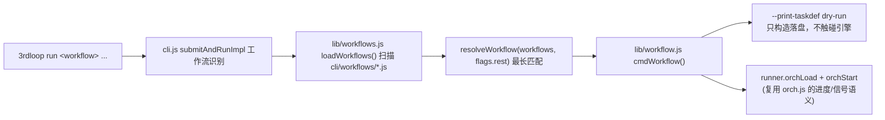

# cli —— 嵌入式引擎 CLI（@ohos-cpf/3rdloop）

本目录是 3rdLibraryLoop 的嵌入式命令行工具包，直接复用 `Server/` 核心引擎
（LoopEngine / Brain / Orchestrator / FlexRunner / TestCheck / Knowledge），
无需启动 HTTP 服务即可从终端跑完整"任务拆解 → 编排执行 → 准出审核"大循环。

> 定位：**嵌入式模式**（`Loop Cli封装计划.md` 方案 A）——单进程内组装核心引擎依赖，
> 仅依赖 AI CLI serve（`CLI_TYPE` 决定 opencode/deveco-code，默认 deveco-code，端口 4096）+ LLM 凭据。
> **双包发布**：本目录是 `@ohos-cpf/3rdloop`（CLI 包），核心在 `@ohos-cpf/3rdloop_core`
> （仓库根即核心包），核心树经四级解析定位，见下文「双包发布与核心树四级解析」。

## 目录结构

```
cli/
├── AGENTS.md            # 本文档
├── package.json         # bin: 3rdloop；files: bin/lib/workflows/README.md（**不含 vendor，也不含前端副本**）
├── bin/3rdloop.mjs         # 入口：argv 解析 + 退出码归一（任何异常 → 1）
├── lib/
│   ├── cli.js           # 命令分发（run/submit/step/orch/web/workflows...）
│   ├── core-paths.js    # 核心树四级解析（零依赖：3LIB_CORE_DIR > 已安装核心包 > vendor > 仓库根）
│   ├── config.js        # 环境装配：项目根/.env 链/数据目录/SKILL 目录/taskId
│   ├── config-cmd.js    # 3rdloop config 配置命令（白名单 .env 读写）
│   ├── update.js        # 3rdloop update 自更新（版本检测/卸载旧版/重装）
│   ├── runner.js        # 核心引擎装配（复用 Server/composition/buildApp.js）+ 执行能力
│   ├── queries.js       # 磁盘直读查询（progress/list/result，不实例化引擎）
│   ├── ui.js            # stdout/stderr 输出契约 + 增量 diff 渲染
│   ├── opencode.js      # AI CLI serve 生命周期管理（opencode/deveco-code，按 CLI_TYPE 选 bin/端口）
│   ├── step.js          # 3rdloop step 单步执行（FlexRunner 直连）
│   ├── orch.js          # 3rdloop orch 多步骤编排（Orchestrator）
│   ├── workflow.js      # 工作流执行器（固定编排入口，本期新增）
│   ├── workflows.js     # 工作流注册表/加载器（目录自动加载，本期新增）
│   ├── serve.js         # 3rdloop serve：同时启动 Server 后端 + Web 前端（含扩展子命令）
│   ├── web.js           # Web 前端服务库（serve 内嵌：静态 + 反代 + 扩展挂载）
│   ├── web-ext.js       # web 扩展机制（manifest 加载 + express 兼容 shim）
│   ├── mcp.js           # 3rdloop mcp：MCP Gateway 装配（install/uninstall/status）
│   ├── knowledge.js     # 3rdloop knowledge：知识打包回收（export/import，人工中转通道）
│   └── exit-codes.js    # 退出码约定
├── workflows/           # 工作流注册目录（每个 .js/.mjs 自动注册一个工作流）
├── scripts/
│   ├── prepack.mjs      # 本地工具（发布态不再用）：生成 cli/vendor/{Server,plugins,core,seams,profiles,MCP,Archive,BadCase,Web/public}
│   ├── clean-vendor.mjs # 本地工具：删除本地 cli/vendor/（并清理历史遗留的 cli/web/）
│   └── verify-deps.mjs  # 三模式校验：已安装核心包 / vendor / 仓库源码 的依赖声明
└── README.md            # 用户文档
```

## 核心机制：依赖注入链（runner.js）

CLI 复用核心引擎的关键是**调用与 HTTP 模式同一份装配（`Server/composition/buildApp.js`），
但不启动 HTTP**。`RunContext._init()` 只表达差异选项，不再手工复刻构造参数：

```js
// ① 先激活宿主（pluginHost 'auto' 时；见下「插件宿主」）
const { host } = await core.activateAppHost({ profile });   // load + 设为进程默认宿主
// ② 再把 host 交给 buildApp：storage/stats/engine-* 等能力从接缝取
const app = await core.buildApp({
    cliType, storageOptions: { rootDir: dataDir }, attachCliArchive: true,
    shareCliWithControllers: true, skillDirectory: skillDir,
    orchestratorSkillDirectory: null, sseHub: null, knowledgeManager: null, host,
});
```

装配结果（`storage` 为用户数据目录）：
```
storage(用户数据目录)
  ├─ CLIController(共享, archive 指向本 storage 的 SessionStore, stats 显式注入)
  ├─ BrainController(注入 cli/orchestratorController/skillDirectory)
  ├─ TestCheck(注入 cli/storage/skillDirectory)
  ├─ LoopEngineController → createLoopEngine()
  └─ orchestratorController.flexRunnerFactory = createOrchestratorFlexRunnerFactory(this)
```

**为什么 `sseHub` / `knowledgeManager` 传 `null`**：
- `SseHub` 构造函数会起心跳 + 清理两个 `setInterval`，CLI 进程持有后无法自然退出；
- 知识库由 `flexRunnerFactory` 按任务惰性创建，命令启动阶段不该额外初始化一份存储根。

### 插件宿主装配（`RunContext` 的 `pluginHost`）

构造参数 `pluginHost` 三态（默认 `'auto'`）：

| 取值 | 行为 | `close()` 时对宿主做什么 |
|------|------|--------------------------|
| `'auto'`（默认） | `activateAppHost({ profile })`：load 宿主 → 设为进程默认宿主 → buildApp 从接缝取 storage/stats/五个引擎（`engine-*` 缺一即 **fail closed**） | 宿主由本进程**创建**，负责 `clearActiveHost()` + `dispose()` |
| `false` | **安全阀**：不装配宿主，`buildApp` 不传 `host`（旧装配路径：内置 `createStorage()` / `StatsService`） | — |
| 宿主实例 | 只做 `setActiveHost(instance)` 激活（不 load、不接管） | **只 `clearActiveHost()` 摘桥，不 dispose** —— 实例的生命周期归调用方 |

> **显式传入的宿主实例，生命周期归调用方；入口只摘桥不销毁。** 调用方给的是「已经 load 好、
> 也可能还要继续用」的宿主（多入口共享、测试里复用同一宿主做多轮断言），`close()` 把它 dispose
> 掉会让调用方拿到 `host.root === null` 的死人（后续 `inject` 直接抛「尚未 load」）。
> 分流只用一个 `ownsHost` 标志，不是两套清理逻辑。

- **安全阀 `3LIB_PLUGIN_MODE=off`**：环境变量一旦为 `off`，等价于 `pluginHost:false`，且**优先于
  构造参数**（应急开关不该被调用方悄悄覆盖）。装配失败、profile 在用户机器上不可用、或新路径
  现场故障时，`3LIB_PLUGIN_MODE=off 3rdloop <cmd>` 即可一键退回旧装配，无需改参数、不用发版。
- **装配失败不降级**（fail closed）：宿主 load 失败直接抛出，错误信息里带
  `3LIB_PLUGIN_MODE=off` 逃生提示。
- **`buildApp` 不改变进程级活跃宿主**（不调 `setActiveHost`）；激活是入口的事。理由：装配点会被
  反复调用（每个 `RunContext`、每个测试），而默认宿主是进程级单例，`core/hostBridge.js`
  （`Server/composition/hostBridge.js` 是转发门面）对它设了**覆盖守卫**（已有另一个不同的
  默认宿主即抛错）。
- **同进程多 `RunContext`**：`runner.js` 用进程级共享宿主 + 引用计数
  （`acquireProcessHost` / `releaseProcessHost`）——第一个上下文激活，其余复用同一宿主并 `refs++`；
  `close()` 递减，**最后一个**关闭的上下文才真正 shutdown（`clearActiveHost()`，仅 `pluginHost:'auto'`
  时再 `dispose()`）。这样既不触发覆盖守卫，也不会出现「先关的人把后关的人的宿主收走了」。
- **`close()` 释放宿主**（幂等）：顺序为 `storage.close()` → `clearActiveHost()` →
  （仅 `ownsHost` 时）`await host.dispose()`。先摘桥再回收，避免回收期间还有代码解析到已释放宿主。

> **出口统一收口（已实现，`test/m12-cli-lifecycle` 用 22 条断言锁定）**：命令模块有 9 个
> `createRunContext()` 调用点，且多处在 `try` **之前**就有早退（例如 ai serve 起不来直接
> `return EXIT.ERROR`）——逐点写 `finally` 必然漏。CLI 是「一进程一命令」，所以收口放在**进程出口**：
> - `cli/lib/lifecycle.js` 维护 RunContext 登记表（**零依赖**：bin 要静态引入它，不能牵出
>   `.env` 链与核心引擎的加载次序）；
> - `createRunContext()` 登记、`RunContext.close()` 注销；
> - `cli/bin/3rdloop.mjs` 的 `finally` 调 `closeAllRunContexts()`：正常完成与抛错两条路径都覆盖；
>   单个上下文关闭失败被隔离、只告警，**不改变已确定的退出码**；
> - 信号处理器会直接 `process.exit`（绕过出口），所以 5 个退出点（`cli.js` / `orch.js`×2 /
>   `step.js` / `workflow.js`）各自在退出前收口。
>
> `close()` 幂等；登记表只做去重与统一遍历。

**关键设计（data 错位教训）**：
- 每个 FlexRunner 通过 `createOrchestratorFlexRunnerFactory` 注入**共享** cli/storage/knowledgeManager，
  避免 opencode 会话归档/知识沉淀落到 vendor 相对路径（`cli/db`）。
- 该 factory **必须用普通 function（非箭头）**——Orchestrator 以
  `this.flexRunnerFactory(node, inputReport)` 调用，`this` 即 Orchestrator 实例，
  需访问 `_taskId` / `_loopCount`。
- `flexRunnerFactory` 的赋值仍留在 runner 里（buildApp 不碰它）：它需要 runner 自己的
  `_activeOrchestrator` / 数据目录上下文，不属于共享装配。

## 双包发布与核心树四级解析

**形态**：两个 npm 包，**不做仓库搬家**。仓库根本身就是核心包
`@ohos-cpf/3rdloop_core`（`Server/ plugins/ core/ seams/ profiles/ MCP/ Archive/ BadCase/` 全部原地保留，
所有相对 import 与 21 条接缝路径一字不改），`cli/` 是 CLI 包 `@ohos-cpf/3rdloop`。

| 包 | manifest | files 白名单 | dependencies |
|----|----------|--------------|--------------|
| `@ohos-cpf/3rdloop_core` | 仓库根 `package.json` | `Server plugins core seams profiles MCP Archive BadCase Web/public Web/ext README.md` | 核心树 import 的全部运行时依赖 |
| `@ohos-cpf/3rdloop` | `cli/package.json` | `bin lib workflows README.md`（**无 vendor、无前端副本**） | `@ohos-cpf/3rdloop_core` + CLI 自己直接 import 的（`dotenv`） |

发版顺序：**先核心包，再 CLI 包**。CLI 的依赖写范围（`^0.0.11`）；`0.0.x` 的 caret 等价于锁 patch，
升核心包 patch 版要同步改 CLI 范围（或放宽成 `>=0.0.11 <0.1.0`）。

### 核心树四级解析（`lib/core-paths.js`，唯一真源）

| 级别 | 来源 | 场景 |
|------|------|------|
| ① | `3LIB_CORE_DIR` | 运维/测试显式覆盖（写错即报错，不静默降级） |
| ② | 已安装 `@ohos-cpf/3rdloop_core`（`createRequire(import.meta.url).resolve('<pkg>/package.json')` + `dirname`） | **双包发布态正路** |
| ③ | `cli/vendor` | prepack 产物（单包回退 / 本地调试） |
| ④ | 仓库根（`cli/` 的上一级） | 开发期直引源码 |

四级都返回同构的「核心树根」，`resolveCoreRoots()` 给出
`{ level, label, coreRoot, serverRoot, pluginsRoot, seamsRoot, profilesRoot, webRoot, webExtRoot }`；
其中 `webRoot = <coreRoot>/Web/public`（核心前端资产也随核心包发布，CLI 侧不再有副本）、
`webExtRoot = <coreRoot>/Web/ext`（可选前端扩展同样随核心包发布，两个派生点在同一处拼接）；
四级全落空时错误信息逐级列出实测结果与可照抄的修法。
`runner.js`（`_loadCore`）、`serve.js`（`Server/Routes/server.js` + `web.js` 的前端资产）、
`mcp.js`（`resolveAssets`）、`config.js`（SKILL 目录 / env 标记）、`doctor.js`（核心包版本检查）
都消费同一份解析结果。
`config.js` 也引用它却不构成循环依赖——`core-paths.js` **零本地依赖**（只用 node 内置模块）。

排障：`3rdloop version` / `version --json` / `doctor` 都打印核心包版本与来源。

### vendor 现在只是本地工具

`prepack` / `clean-vendor` 保留，但**发布态不再使用 vendor**（`files` 不含 `vendor`，产物不进 tarball）：
- `prepack`：生成 `cli/vendor/`（核心副本，供第③级，含 `vendor/Web/public` 前端副本），
  写 `vendor/VERSION`、扫描敏感文件；`vendor/Server/package.json` 的 dependencies 对齐**核心包** manifest。
- `postpack`（clean-vendor）：删除本地 `cli/vendor/`，并清理历史遗留的 `cli/web/`，删完断言两者都不存在。
- **`cli/web` 已退役**：前端资产随核心包发布（`<核心树根>/Web/public`），CLI 包内不再有前端副本；
  `cli/package.json` 的 `files` 也不再含 `web`。
- 核心包整包发布后**不再需要**维护 `CORE_MODULES` 白名单；但若继续用 vendor 做本地调试，
  白名单仍需同步（`composition/` 是 `buildApp` 的落点，漏了第③级会 module not found）。

资产（MCP/Archive/BadCase）三种形态同构：SKILL 里的
`{{skillDir}}/../../../MCP/scripts/*.cjs` 与 McpToolGuide 的 `Server/library → ../../MCP/config.json`
在安装态（核心包根）、vendor 态、仓库态都是同一相对深度。

### verify-deps 三模式

| 模式 | 触发 | 核心树扫描目录 | 核对 manifest |
|------|------|----------------|----------------|
| ① installed | `node_modules/@ohos-cpf/3rdloop_core` 可解析 | `<核心包>/{Server,MCP/src,Archive/src,plugins,core,seams,profiles}` | **核心包 `package.json`** |
| ② vendor | `cli/vendor/Server` 存在 | `vendor/{Server,MCP/src,Archive/src,plugins,core,seams}` | 已装核心包 → 仓库根 → `cli/package.json`（遗留单包形态） |
| ③ repo | 仓库 `Server/` 存在 | 仓库根同名目录 | 仓库根 `package.json`（= 核心包 manifest） |

三种模式都额外扫 `cli/{lib,bin,workflows}` 并比对 `cli/package.json`。
`dotenv` 是唯一在两个包中各声明一次的依赖：`Server/composition/envBootstrap.js`（核心树）与
`cli/lib/config.js`（CLI 自身）各自直接 import，任一侧缺失都会在该侧运行路径上报错；
两组扫描各认自己的 manifest，漏在任一包里都会被扫出来。

## mcp 命令（MCP Gateway 装配）

- 实现：`lib/mcp.js`，分发：`cli.js` `case 'mcp'`（惰性 import）。命令：
  `3rdloop mcp install [--cli opencode|deveco|all] [--force]` / `uninstall [--cli ...]` / `status`。
- **install 三步**：① 生成用户级配置 `~/.3lib/3rdloop/mcp/config.json`（scriptsDir/enginePath
  指向包内绝对路径，knowledgeBase.dataDir 指向 `~/.3lib/3rdloop/kb-data`；已存在仅刷新路径
  字段，保留 downstreamServers 等用户改动，--force 重置）② 种子复制 kb-data（← Archive/data）
  与 BadCase 副本（已存在跳过，保用户数据）③ 注册 `mcp-gateway` 到
  `~/.config/opencode/opencode.json` 与 `~/.config/deveco/deveco.jsonc`（保留其他字段，幂等）。
- **资产定位**：`resolveAssets()` 走同一份核心树解析（已安装核心包 → vendor → 仓库根），
  开发态 `3rdloop mcp install` 直接用仓库 `MCP/`，安装态用核心包的 `MCP/`。
- **deveco.jsonc 为 JSONC**：readJsonc 容错解析（剥注释重试），失败提示手动处理。
- **doctor 集成（自动装配）**：`3rdloop doctor` 默认 `fix=true`——collectChecks 的「MCP Gateway
  装配」检查（warning: true）未通过时，自动调用 `mcpInstall` 装配并复查回填检查项；`--no-fix`
  仅诊断。装配失败不阻断 doctor（仍为警告级，提示手动 `3rdloop mcp install`）。
- **precheck 零副作用约定**：`precheckEnv`（run/submit/step/orch/workflow 前置）复用同一检查集
  但**不自动装配**——任务命令不得偷偷改用户全局配置；未装配仅在 stderr 提示一行（警告级不阻断）。
- **为什么需要用户级配置**：kb 数据与 BadCase 是可写数据，落包目录会随 npm 更新被清除；
  scripts/engine 是代码，随包走获得更新。注册 command 指向包内入口 + 用户级 config。

## knowledge 命令（知识 JSON 打包回收，人工中转通道）

- 实现：`lib/knowledge.js`，分发：`cli.js` `case 'knowledge'`（惰性 import）。
- **export（用户侧）**：打包 `<dataDir>/Knowledge/` 下全部 JSON（index.json 登记表 +
  kn_*.json 知识条目，**只打 JSON，不含 md/kb-data/BadCase**）→ 单成员 zip
  （内含 payload.json：manifest + knowledgeFiles）。`--note` 备注、`--output` 路径覆盖。
- **import（维护者侧）**：解包到收件箱 `~/.3lib/3rdloop/knowledge-inbox/<来源主机>-<导出日期>/`
  ——多用户包互不冲突、**不覆盖本地 Knowledge 库**，人工评估后自行入库。`--dry-run` 预演。
- **zip 实现**：纯 Node 零依赖（zlib.deflateRawSync + 手写 local header/central
  directory/EOCD）。**坑**：EOCD 的 central directory size 字段必须含文件名长度
  （header 46 + name），否则 python zipfile 报 "Bad magic number for central directory"、
  unzip 报 "12 extra bytes"。
- **Knowledge 目录跟随 `--data-dir`**（npm 安装态默认 ~/.3lib/3rdloop/db/Knowledge；
  仓库开发态可能被 3LIB_DATA_DIR 覆盖到仓库 db/）。

## 输出契约

- **stdout**：只放 `--json` 结构化数据或最终结果（脚本可安全解析）
- **stderr**：进度日志 / 诊断信息
- `cli.js` 顶部 `_redirectStdoutLogs()` 把 Server 内部 `console.log/info` 重定向到 stderr，
  `console.debug` 丢弃，保护 `--json` 通道纯净
- **退出码**：`0` 通过 / `1` 参数或环境错误 / `2` 任务失败 / `3` wait 超时 /
  `130` SIGINT / `143` SIGTERM

## 工作流机制（本次新增）

### 定位

**固定编排 = 预置 taskDef 定义 + CLI flags 参数化 + 复用 orch 链路。**
前端（`Web/public/js/*librarycheck.js`）就是这种模式（硬编码 `_RN_STEP_DEFS` 等
steps 定义 → `POST /api/orchestrator/load` → `start`）。CLI 工作流是其命令行等价物：
`3rdloop run <工作流名> --flag <值>` → 运行时构造具参 taskDef → 复用 `orchLoad` + `orchStart`。

### 运行链路



### 工作流文件约定（cli/workflows/*.js）

每个文件默认导出一个对象即可自动注册：

```js
export default {
  name: 'pr push',                 // 多词名，空格分隔；分发时最长匹配
  description: '简述',
  params: [                        // CLI flags schema（驱动校验 / --help）
    { flag: 'workspace-dir', required: true,  describe: '...' },
    { flag: 'upstream-url', required: false, describe: '...' },
  ],
  buildTaskDef(params, env) {      // params: { 'workspace-dir': <值>, ... }
    return {
      taskId: '',                  // 缺省时 CLI 补全（generateTaskId()）
      title: '...',
      skillDirectory: '',
      loopCount: 0,
      steps: [{ stepId: 1, taskDescription: '...', specifiedSkill: '...',
                dependId: 0, nextStepId: 0, failStepId: 0, maxRetries: 3, inputReport: '' }],
    };
  },
};
```

- steps 格式与 `3rdloop orch run <task-def.json>` 的 taskDef 完全一致（Orchestrator.loadTask 协议）
- 步骤职责能匹配某可用 SKILL 时写入 `specifiedSkill`（执行层跳过 SkillSelector）
- `buildTaskDef` 第二参 `env` 携带 `{ dataDir }`，需要落盘相对路径时使用

### 命令面

- `3rdloop workflows`：列出已注册工作流（json / 文本）
- `3rdloop run <wf> --help`：打印该工作流参数说明（退出码 0）
- `3rdloop run <wf> ...` / `3rdloop submit <wf> ...`：执行（两者都支持工作流名）
- `3rdloop run <wf> ... --print-taskdef`：dry-run，构造并落盘 `task-def.dry.json`，不触碰引擎

**分发规则**：`submitAndRunImpl` 先用 `loadWorkflows()` + `resolveWorkflow()` 对
`flags.rest` 做最长匹配；**命中 → 转发 cmdWorkflow()；未命中 → 保持原"任务描述"语义**
（向后兼容 `3rdloop run "检视 xxx"` 完全不变）。

### 已知坑 / 实现要点

- **加载失败不阻断**：`loadWorkflows()` 对加载失败/缺 name/重名模块只记 warnings 跳过，
  但所有工作流目录为空时 `3rdloop workflows` 应给指引（退出码 0）。
- **taskId 必填**：`runner.orchLoad` 要求 `taskDef.taskId` 非空；工作流未显式给时，
  执行器在构造后统一补 `generateTaskId() + '_wf'` 后缀。
- **`--print-taskdef` 不触 opencode**：dry-run 分支在 `_ensureOpcodene` 之前返回，
  验收已实测不会拉起/连接 opencode。
- **多词匹配截断**：`resolveWorkflow` 只对连续位置参数前缀匹配（遇 `--flag` 截断），
  避免把 flag 值错当工作流名。
- **未知 flag 报错**：执行器校验 `--print-taskdef` 之外的未声明 flag → 退出码 1。
- **信号处理**：正式执行沿用 orch.js 模式——SIGINT/SIGTERM → `orchControl(abort)` →
  `oc.stop()` 清 opencode 子进程 → 退出 130/143。

### 职责边界（重要）

- **本期只交付机制，不预置业务工作流**（`pr push` 等由其他项目开发者按约定注册）
- **不改动 `Server/Skills/` 下任何 SKILL**；业务 SKILL 归其他开发者维护
- 工作流只做"参数 → taskDef"，执行细节由 `specifiedSkill` 绑定的 SKILL 承载

## 如何新增一个固定编排命令（面向 AI agent）

**一句话**：在 `cli/workflows/` 下新建一个 `.mjs` 文件，默认导出工作流声明对象，自动注册为
`3rdloop run <name>` 命令。零改动分发代码。

**范本**：[`cli/workflows/pr-check.mjs`](workflows/pr-check.mjs) 是最简完整示例，新建工作流时先通读它。

### 第 1 步：新建文件

在 `cli/workflows/` 下新建 `<name>.mjs`（文件名随意，但建议与 `name` 字段一致）。默认导出一个
对象即可自动注册，无需改动 `cli/lib/cli.js` / `workflows.js` / `workflow.js`。

### 第 2 步：声明 name 与 description

- `name`：命令名，用户通过 `3rdloop run <name>` 触发。**用连字符单词**（如 `pr-check`、`pr-push`），
  不用空格分隔多词——连字符写法语义清晰，避免"是否逐级路由"的歧义。
- `description`：一句话简述，供 `3rdloop workflows` 列表与 `--help` 展示。

### 第 3 步：声明 params（CLI flags schema）

`params` 是数组，每项 `{ flag, required, describe }`：

- `flag`：去掉 `--` 前缀的参数名，如 `pr-url`
- `required`：是否必填（缺填时执行器报错退出码 1）
- `describe`：帮助文本

执行器据此做：必填校验、未知 flag 报错、`--help` 渲染。`--print-taskdef` 是框架级 flag，无需声明。

### 第 4 步：实现 buildTaskDef(params, env)

核心职责：把 CLI 参数构造为与 `Orchestrator.loadTask` 对齐的 taskDef 对象。返回值必须包含
`taskId` + 非空 `steps` 数组。

- `params`：`{ 'pr-url': <值>, 'library-type': <值>, ... }`，key 与 `params[].flag` 对应
- `env`：`{ dataDir }`，需落盘相对路径时使用
- 必填参数缺失时主动 `throw new Error(...)`，执行器会捕获并报错退出码 1
- 非法参数值（如不支持的枚举）同样 throw

taskDef 字段约定（与 `3rdloop orch run <task-def.json>` 完全一致）：

```js
return {
  taskId: '',              // 缺省时 CLI 补 generateTaskId()+'_wf'；需与前端协同时自定义前缀
  title: '...',             // 供前端历史页解析（可编码类型/参数）
  skillDirectory: '',      // 留空用默认 Server/Skills
  loopCount: 0,
  steps: [{
    stepId: 1,
    taskDescription: '...',  // 发给 LLM 的任务描述
    dependId: 0,            // 0=无依赖（入口步骤）
    nextStepId: 0,          // 0=成功后无后续
    failStepId: 0,          // 0=失败即终止
    maxRetries: 3,
    skillDirectory: '',
    specifiedSkill: '...',   // 绑定 SKILL（name 或目录名），跳过 SkillSelector 自动匹配
    inputReport: '',
  }],
};
```

### 第 5 步：dry-run 验收

新建工作流后必跑（零 LLM 成本）：

```bash
# 1. 列表能查到
node cli/bin/3rdloop.mjs workflows

# 2. 参数说明正常
node cli/bin/3rdloop.mjs run <name> --help

# 3. dry-run 构造的 taskDef 正确
node cli/bin/3rdloop.mjs run <name> --<必填flag> <值> --print-taskdef

# 4. 缺必填 / 非法值 / 未知 flag → 退出码 1
node cli/bin/3rdloop.mjs run <name> --print-taskdef    # 缺必填
```

验收后清理 dry-run 产物（`<数据目录>/task/<taskId>/task-def.dry.json`）。

### 易踩坑提醒

- **name 用连字符**：`pr-check` 而非 `pr check`。路由是注册表查找式（`resolveWorkflow` 把位置参数
  `join(' ')` 拼字符串查 Map），不是逐级 switch 分发；连字符写法让"一个命令"的语义更清晰。
- **specifiedSkill 要对**：值必须是 `Server/Skills/` 下某 SKILL 的目录名或 frontmatter `name` 字段；
  解析失败会降级为无 SKILL 模式（仍耗 LLM 但不按预期执行）。
- **taskId 前缀与前端协同**：若希望 CLI 提交的任务在前端某历史页可见，taskId 前缀需与前端过滤条件
  一致（如 PR 检视页用 `taskIdPrefix=codecheck_`）。参考 `pr-check.mjs` 的
  `codecheck_{owner}_{repo}_{prNum}_{ts36}` 格式。
- **不改 SKILL**：工作流只做"参数 → taskDef"，执行细节由 `specifiedSkill` 绑定的 SKILL 承载。
  新增业务能力应注册新工作流 + 复用现有 SKILL，不改动 `Server/Skills/`。

## serve 命令（后端 + Web 前端一体启动）

- 实现：`lib/serve.js`（命令编排：后端 + 前端 + 扩展子命令）+ `lib/web.js`（Web 前端服务库）+
  `lib/web-ext.js`（扩展 manifest 加载 + 轻量 express 兼容 shim），分发：`cli.js` `case 'serve'`（惰性 import）。
  后端复用 `Server/Routes/server.js` 的 createServer；前端**进程内启动**（node:http 零新增依赖，
  SSE 反代语义复刻 `Web/server.js`，不再 spawn Web/server.js 子进程）。
- 命令：`3rdloop serve [--port 3000] [--web-port 8080] [--web-root <dir>] [--ext-root <dir>]...
  [--ext <name,...>] [--no-ext] [--open]`；子命令 `install-ext <dir>` / `list-ext` / `remove-ext <name>`。
- **Web 前端随 serve 默认启动**（原独立 `3rdloop web` 命令已移除；`-w/--web` 仅兼容接受并提示；
  用户误输 `3rdloop web` 时 cli.js 给出迁移提示并退出码 1）。
- **典型模式**：仓库内 `node cli/bin/3rdloop.mjs serve` = 后端 + 核心前端 + `Web/ext/` 全部扩展；
  `3rdloop serve --no-ext` = 纯后端操作（仅核心工作台，`--no-ext` 优先于 `--ext`，不受已安装扩展影响）；
  `--ext tag,issue` = 白名单挂载（未发现的名字打 stderr 警告）。
- **设计（方案 A+D）**：核心前端（PR/仓库检视 + loop/knowledge）**随核心包发布**；tag/issue/prcheck 等
  二级目录功能以"扩展"形式**同样随核心包发布**（`<核心树根>/Web/ext`），安装态自动发现、无需 `install-ext`：
  - 前端资产解析：`--web-root` > `3LIB_WEB_ROOT` > 核心树 `Web/public`（`coreRoots.webRoot`：
    安装态=核心包 `<包根>/Web/public`、vendor 态=`cli/vendor/Web/public`、开发态=仓库 `Web/public`）> 抛错
    （错误信息列出三级实测结果与可照抄修法；`cli/web` 回退已退役）
  - 扩展根解析：`--ext-root` > `3LIB_WEB_EXT_ROOT` > 仓库 `Web/ext`（开发态）> **核心树 `Web/ext`**
    （`coreRoots.webExtRoot`：安装态=核心包 `<包根>/Web/ext`、vendor 态=`cli/vendor/Web/ext`、
    开发态=仓库 `Web/ext`，存在才用）> `~/.3lib/3rdloop/web-ext`（用户安装）
    ——开发态的「仓库 `Web/ext`」与「核心树 `Web/ext`」是**同一个绝对路径**，按 `realpath` 去重，
    同一目录不会重复挂载同名扩展；`--no-ext` 一并关掉核心包里的扩展（`--ext <names>` 白名单语义不变）
  - 扩展数据目录：`<dataDir>/web-ext/<name>`（跟随 `--data-dir`，**不随扩展来源变化**）；
    扩展同名时先注册者优先（开发态仓库源 / 核心树源优先于用户安装）
- 路由优先级：`/api/ext-registry`（本地响应）→ `/<mount>` 扩展（页面/API/静态）→ `/api/*`、`/stream*` 后端反代 → 核心前端静态。
- 启动顺序：Web 前端先监听（端口冲突在后端启动前快速失败）→ 再起 Server 后端；两者端口相同直接报错。
- 扩展协议：`Web/ext/<name>/manifest.json`（name/title/mount/order/server/page）+ `router.cjs`
  （`module.exports.createExtRouter({ express, Database, dbDir, serverRoot, logger })`）+ `public/`。
  shim 仅支持 `get/post/put/patch/delete`（`:param` 路径参数、`req.params/query/body`、
  `res.status/json/send/setHeader/end/sendFile`），**不支持** `router.use`。
- prepack 把 `Web/public → vendor/Web/public`（第③级 vendor 态自洽），**不再生成 `cli/web`**；
  `cli/package.json` 的 files 不含 `web`，postpack（clean-vendor）删 `cli/vendor/` 并顺手清理历史遗留的
  `cli/web/`，删完断言两者都不存在。
- 前端导航：`Web/public/index.html` 的 `#nav-ext-section` + `navigation.js` `ExtNav` 经
  `/api/ext-registry` 动态渲染扩展入口（端点缺失/无扩展时静默隐藏，兼容旧版 `Web/server.js` 纯静态部署）。
- 退出码：常驻服务，SIGINT→130 / SIGTERM→143（信号处理器必须在 createServer **之前**注册，
  否则 Server 内部的退出码 0 处理器会抢先）；端口占用 EADDRINUSE→1。

## 环境预检（precheck，本期新增）

- 实现：`lib/doctor.js`——`collectChecks()`（doctor 与预检共用的检查集，每项含 `fix` 修复提示，
  如 `3rdloop config set DASHSCOPE_API_KEY <sk-xxx>`）+ `precheckEnv()`（预检）+
  `reportPrecheckFailures()`（失败报告打印，各入口共用）。
- **触发命令**（正式执行引擎/LLM 前调用）：`run` / `submit`（含工作流正式执行）、
  `step run`、`orch run` / `orch start`。任一项不通过直接退出码 1（区别于任务失败 2），
  避免环境问题跑到一半才失败、被误报为任务失败。
- **不预检的路径**：`--print-taskdef` dry-run（保持"不触引擎"约定）、`orch load`（仅落盘
  taskDef）、`wait`/`progress`/`list`/`result` 等磁盘查询命令。
- 语义差异（相对 doctor）：serve 未运行**不算失败**（执行命令时会自动拉起；
  端口有响应但异常仍算失败，提示清理残留进程）。
- LLM 凭据检查用**生效环境**（`process.env.DASHSCOPE_API_KEY`，loadEnvChain 已注入
  系统环境变量 > `~/.3lib/.env` > 项目 `Server/.env` 三层），仅强制 `DASHSCOPE_API_KEY`
  （`LLM_BASE_URL`/`LLM_MODEL` 引擎有内置默认值，见 `Server/Agent/SkillSelector/llm/llmClient.js`）。
- doctor 输出同步升级：失败项附加 `修复:` 行（与预检一致），照抄命令即可配置。

## 命令家族

| 层 | 命令 | 复用引擎 |
|----|------|---------|
| 任务生命周期 | `run`/`submit`/`wait`/`progress`/`abort`/`list`/`result` | LoopEngine 全闭环 |
| 单步直通 | `step run`/`status`/`result` | FlexRunner 直连 |
| 固定编排 | `orch run`/`load`/`start`/`progress`/控制/`tasks` | Orchestrator |
| **工作流** | `3rdloop run <wf>`/`3rdloop workflows` | Orchestrator + 注册表 |
| 配置 | `config list/get/set/unset` | ~/.3lib/.env 白名单读写 |
| **MCP 装配** | `mcp install/uninstall/status` | 注册 Gateway 到 AI CLI + 种子复制 kb/BadCase 数据 |
| **知识回收** | `knowledge export/import` | 本地知识打包 zip（用户侧）/ 解包合入（维护者侧） |
| **服务/前端** | `serve`/`serve install-ext|list-ext|remove-ext` | Server 后端 + 静态托管 + 反代 + 扩展挂载 |
| 运维 | `doctor`/`version`/`update` | check-env 维度（按 CLI_TYPE 检测 AI CLI + serve 连通性）+ npm registry |

## 环境约定

- `.env` 加载链：系统环境变量 > `~/.3lib/.env`（用户级） > 项目根 `Server/.env`。
  `loadEnvChain` 必须在任何核心引擎 import 前执行（使 Server 内部 dotenv 变静默 no-op）。
- 数据目录：`~/.3lib/3rdloop/db`（`--data-dir` / `3LIB_DATA_DIR` / `config set 3LIB_DATA_DIR` 可覆盖），任务写
  `<数据目录>/task/{taskId}/`。
- AI CLI（`CLI_TYPE`，默认 deveco-code）：`run`/`step run`/`orch run|start`/`run <工作流>` 的 `cliType`
  统一经 `config.js resolveCliType()` 解析（显式参数 > `CLI_TYPE` env/.env 链 > deveco-code），并传给
  `CLIController` 与 `CliServeManager`（`lib/opencode.js`）：自动拉起 `deveco serve` /
  `opencode serve --port <port>`（项目上一级 cwd，端口取 `OPENCODE_PORT`/`DEVECO_PORT`，默认 4096），
  已运行则复用；退出时清理进程树（Windows 用 `taskkill /pid X /T /F`）。`CLI_TYPE` 写了无效值时
  回退默认值 deveco-code 并 stderr 告警（doctor 会将其报为失败项）。

## config 命令（`.env` 配置项）

- 实现：`lib/config-cmd.js`，白名单 `ENV_KEYS`（key/label/description/default/validate/secret/envOnly）。
- 写入目标：用户级 `~/.3lib/.env`（跨项目全局），`loadEnvChain` 加载它，故 `set` 后立即生效。
- 读取优先级：系统环境变量 > 用户 `~/.3lib/.env` > 项目 `Server/.env` > 内置默认值。
  来源识别：`effectiveValue()` 直接解析各层文件比对（因 `loadEnvChain` 已把所有 `.env` 注入
  `process.env`，无法用 `process.env` 反推来源，必须读文件比对）。
- 密钥脱敏：`DASHSCOPE_API_KEY`/`GIT_TOKEN` 等 `secret:true` 的键在 `get`/`list` 只显示部分，`set` 不回显。
- 易踩坑：
  - `dotenv.parse` 需同步加载：`_dotenv()` 用 `createRequire` 同步 require（`import()` 返回 Promise 会失效）。
  - `~` 展开：`3LIB_DATA_DIR` 等默认值用 `expandHome` 展开成绝对路径。
  - `3LIB_ROOT`/`3LIB_HOME` 是 `envOnly`：`.env` 写入不生效，`config set` 拒绝并提示 `setx/export`。
  - 未知键 set 报错；行级写入保留注释/其他键（`applyEnvKey`/`removeEnvKey`）。

## update 命令（自更新）

- 实现：`lib/update.js`，分发：`cli.js` `case 'update'`（惰性 import）。
- 命令：`3rdloop update [--check] [--yes] [--registry <url>]`。
- 流程：`getCliVersion()`（本地）→ `npm view @ohos-cpf/3rdloop version`（registry，尊重用户镜像，
  失败回退 packument API）→ `compareVersions` 判断 → 交互确认 → 卸载旧版 + `npm install -g ...@latest` 重装。
- registry 覆盖：`--registry` 追加到 `npm view`/`npm install`；默认用 `npm config get registry`
  （兼容 npmmirror 等镜像）。所有 npm 调用统一经 `runNpm(args, opts)` 封装。

### 从 GitHub Release 升级（`--from-release`）

发布渠道是**GitHub Release 附件**（见 `README_DEVELOP.md` 的「打发布产物」），包不在公共 npm
registry 上 —— 因此从 Release 安装的用户跑默认路径必然失败（`npm view` 404）。这条路径补上它：

```
3rdloop update --from-release [<tag>] [--check] [--yes]
               [--release-api <base>] [--release-repo <owner/repo>] [--prefix <dir>] [--registry <url>]
```

| 参数 | 说明 |
|------|------|
| `--from-release` | 开关；紧跟的非 flag token 视为 tag（给 = 该 tag，不给 = latest） |
| `--release-api <base>` | 默认 `https://api.github.com`，只接受 http(s)（自建镜像/测试用） |
| `--release-repo <owner/repo>` | 缺省从 **CLI 包 → 核心包** 的 `repository` 推导（认 `git+https://`、`https://`、`git@host:o/r.git`、含端口 URL）；两处都推不出就报错并列出试过的 manifest |
| `--prefix <dir>` | 把"全局安装"落到该前缀（`npm root -g --prefix` 回读，另有 `<prefix>/[lib/]node_modules` 兜底） |
| `--check` | 可与 `--from-release` 组合：只打印当前/release 版本、是否需要更新、两 asset 名与体积，**不下载不落盘** |

流程：`GET {api}/repos/{repo}/releases/{latest|tags/<tag>}`（`user-agent` 必填、无 Authorization、
15s 超时）→ 从 `assets` 只挑 `.tgz`（含 `3rdloop_core` = 核心包；含 `3rdloop` 且不含 `_core`
= CLI 包；**缺任一即报错并列出实际名单** + `gh release upload/view` 命令）→ `os.tmpdir()` 下
`mkdtemp` 下载（60s 超时）→ **一次** `npm i -g <core.tgz> <cli.tgz>`（一次装两个，避免 CLI 去
registry 找旧版核心包）→ `npm root -g` 回读两个 `package.json` 版本，与 tag 不一致只告警
（`versionMismatch:true`）。

- **临时目录清理是可审计输出**：`--json` 结果里带 `download: { dir, cleaned }`；`try` / `catch` /
  `finally` 三处都调幂等清理，`fs.rm` 带重试（Windows 上杀毒/索引器短暂占用刚写入的 tarball 是真事）。
- **`--from-release` 是"装这个 release"的显式请求**：即使当前版本等于/高于 tag 也会装（可作为
  幂等修复手段），只在 `upToDate` 里如实标注——这意味着它也能"降级"。
- 已知取舍：中途 Ctrl+C 打断在"下载后、清理前"会留下一个 `3rdloop-release-*`（TEMP 内）；
  `--prefix` 会绕过用户 npm prefix 配置，bin shim 落在 `<prefix>` 而不在 PATH 里；
  `--release-api/--release-repo/--prefix` 不支持 `--flag=value` 写法（与既有 `--registry` 一致）。
- **默认 npm 路径行为未变**（连 `--help` 也只多了文档行）。注意默认路径有两个**既有**坑：
  `update --registry <url>` 与 `update -y` 会被"未知参数"拒绝（旧 `unknowns` 过滤把任何非 `--`
  token 当位置参数）——Release 路径已放行新 flag 的取值位置，默认路径待单独立项修。

- 易踩坑：
  - **不手动改 node_modules**：更新统一走 `npm install -g` 全量重装，保证依赖自洽。
  - **Windows 下 npm 是 `npm.cmd`**：`execFileSync('npm')` 的 CreateProcess 无法执行批处理 shim，
    抛 `spawnSync npm ENOENT`。`runNpm` 在 win32 用 `shell:true`（cmd 按 PATHEXT 解析 npm.cmd，
    已被 cmd.exe 转义防注入），POSIX（macOS/Linux）保持 `shell:false` 直接调用，行为零变化。
  - **`--registry` 注入防护**：`runNpm` 在 win32 分支对 `--registry` 值做 http(s) URL 白名单校验
    （拒绝空白/引号/`&|<>^();%` 等元字符），其余参数均为代码内常量，无用户输入面。
  - **非 TTY 交互确认自动拒绝**：脚本化必须 `--yes`。
  - **`--help` 不联网**：`cmdUpdateImpl` 先处理 `-h/--help` 打印用法后返回，避免无网络环境卡死。
  - 更新只替换程序文件，数据目录 `~/.3lib/3rdloop/db` 与 `~/.3lib/.env` 不受影响。

## 自检清单

改动 cli 后至少验证：语法 `node --check`、`node bin/3rdloop.mjs workflows`、
新工作流 `--help` 与 `--print-taskdef`、缺参/未知 flag 退出码 1、
回归冒烟（后端依赖）`npm run verify-deps` + 现有测试。